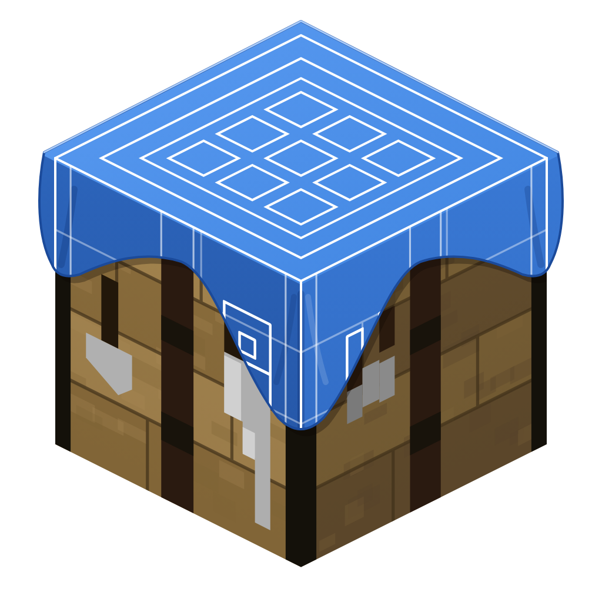

  <h1>CraftDock</h1>
  
A lightweight, modern Minecraft launcher built with Electron.

  
  
  
  

 
  
 

---

> 🟢 **CraftDock is now in Public Beta.** Anyone can download it — no invite or tester access needed.
> Features may still change and bugs are expected. Grab the latest build from [Releases](https://github.com/Geegamr/CraftDock/releases).
> Found something broken? [Open an issue](https://github.com/Geegamr/CraftDock/issues) or [join the Discord](https://discord.gg/zfmemagrZR).

---

## Features

- **Modpack browser** — search and install from Modrinth and CurseForge
- **Import / Export** — import CurseForge `.zip` or Modrinth `.mrpack`; export as zip, mrpack, CF code, or Modrinth link
- **Instance manager** — isolated folder per instance with mods, saves, configs, screenshots, and resource packs
- **Mod browser & version picker** — browse Modrinth with version compatibility badges for your MC version and loader
- **Mod update checker** — check and update mods per-instance individually or in bulk
- **Direct Java launch** — no external launcher needed; supports Fabric, Forge, NeoForge, and Quilt
- **Auto Java management** — picks the right Java per MC version; auto-downloads it privately if missing — system Java never touched
- **Server manager** — Paper, Purpur, Vanilla, Fabric, or Forge servers with live console, backups, and auto-shutdown
- **Join server from launcher** — launch an instance and connect to a server in one click
- **World / Server / Resource Tags** — symlink `saves/`, `servers.dat`, or `resourcepacks/` across multiple instances
- **Resource pack, shader & data pack browser** — Modrinth browser with version picker, installs directly to any instance
- **Config file editor** — edit `.toml`, `.json`, `.yaml`, `.cfg` and more directly in the launcher; system editor optional via Settings
- **Screenshots viewer** — in-app lightbox with prev/next navigation and keyboard shortcuts
- **Skin manager** — 3D preview, cape selector, and player skin downloader
- **Microsoft login** — device code OAuth with AES-256-GCM encrypted token storage and silent background refresh
- **Playtime tracking** — hours played per instance shown on the home dashboard
- **Updates in place** — CraftDock checks for a new release on launch, then downloads and restarts itself when you say so, or on its own if you turn on automatic updates (portable and installed builds both)

---

## Beta Roadmap

| Milestone | Target |
|-----------|--------|
| Closed Beta | Done |
| CurseForge Browsing | Shipped (v0.6.3) |
| Export / Import | Shipped (v0.6.3) |
| Bug fixes & polish before public release | Shipped (v0.7.0) |
| In-app updater | Shipped (v0.8.0) |
| Public Beta (current) | **Now** |
| v1.0 Release | TBD |

Public beta is open to everyone — install from [Releases](https://github.com/Geegamr/CraftDock/releases), report issues on GitHub, and follow progress on the [Discord](https://discord.gg/zfmemagrZR).

---

## Versioning

Versions are `MAJOR_VERSION.MAJOR_BUG_FIX.MINOR_BUG_FIX`, three numbers, bumped by position:

| Position | Bumped for | Example |
|----------|-----------|---------|
| `MAJOR_VERSION` | A milestone or a change that breaks compatibility with older data | `0.9.0` → `1.0.0` |
| `MAJOR_BUG_FIX` | A significant batch of fixes, or a new feature | `0.7.1` → `0.8.0` |
| `MINOR_BUG_FIX` | One small, contained fix | `0.8.0` → `0.8.1` |

`package.json` is the only place a version is written. The main process reads it, the window asks the main process for it, and every label and User-Agent string is built from that one value — nothing is typed twice. The updater compares the three numbers numerically, so `0.10.0` is newer than `0.9.0` and a local build ahead of the newest release is never told to update.

---

## Contributing

Bug reports via [GitHub Issues](https://github.com/Geegamr/CraftDock/issues) are welcome. Please include your OS, Electron version, and steps to reproduce.
For general feedback and discussion, join the [Discord server](https://discord.gg/zfmemagrZR).

---

## Credits

- The CraftDock logo is heavily inspired by [ATLauncher](https://atlauncher.com)'s icon, which has been one of my favourite launcher looks since the early days. Thanks to the ATLauncher team. CraftDock is not affiliated with ATLauncher and is not endorsed by it.
- Built with [Electron](https://www.electronjs.org), with native helpers in Rust.

---

## License

Apache 2.0 — see [LICENSE](LICENSE) for details.

---

  
    
  Built with Electron · Not affiliated with Mojang or Microsoft

